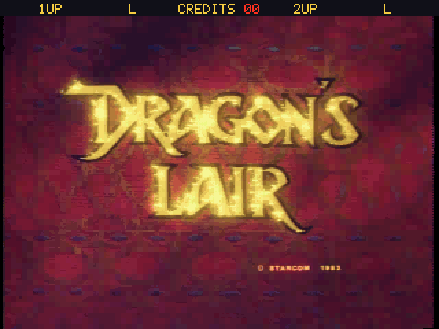
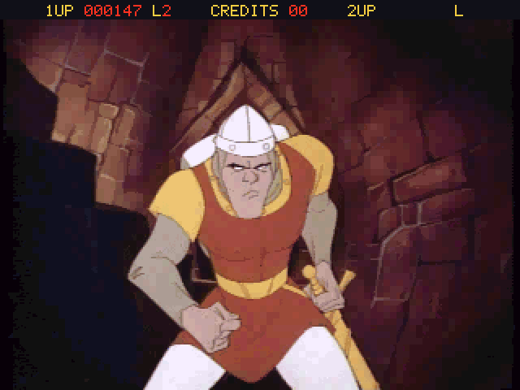

# pico-dragonslair

**pico-dragonslair** is an emulator of the laserdisc arcade game **Dragon's Lair** (Cinematronics, 1983) for RP2350-based microcontroller boards, with video and audio over DVI/HDMI. It emulates the original US board (revision F2): the Zilog Z80 CPU, the AY-3-8910 sound chip and the LED scoreboard. It also emulates, at command level, the Pioneer LD-V1000 laserdisc player that supplies all pictures and sound of the game. The laserdisc is played from the SD card. The board is a port of [MAME](https://www.mamedev.org/)'s Dragon's Lair driver and Z80 core. The laserdisc player follows [Hypseus Singe](https://github.com/DirtBagXon/hypseus-singe), the successor of DAPHNE.

It uses the same menu, display, audio and controller framework as this family of emulators:

- NES: [pico-infonesPlus](https://github.com/PicoPlus-devel/pico-infonesPlus)
- Super Nintendo: [pico-snesPlus](https://github.com/PicoPlus-devel/pico-snesPlus)
- Sega Master System / Game Gear: [pico-smsplus](https://github.com/PicoPlus-devel/pico-smsplus)
- Game Boy / Game Boy Color: [pico-peanutGB](https://github.com/PicoPlus-devel/pico-peanutGB)
- Sega Mega Drive / Genesis: [pico-genesisPlus](https://github.com/PicoPlus-devel/pico-genesisPlus)
- OutRun: [pico-outrun](https://github.com/PicoPlus-devel/pico-outrun)
- Phoenix: [pico-phoenix](https://github.com/PicoPlus-devel/pico-phoenix)
- Moon Cresta: [pico-mooncresta](https://github.com/PicoPlus-devel/pico-mooncresta)

pico-dragonslair runs standalone, or as an application of [pico-bootLoader](https://github.com/PicoPlus-devel/pico-bootLoader), where it appears in the **Arcade** category.

**The game data is not included and must be supplied by the user.** Dragon's Lair is copyright Cinematronics and Don Bluth; neither the ROM set nor the laserdisc is distributed with this project. See [Game data](#game-data).

***

## Screenshots

<table>
  <tr>
    <td></td>
    <td></td>
  </tr>
  <tr>
    <td align="center">Attract mode</td>
    <td align="center">In the game, with the scoreboard</td>
  </tr>
</table>

***

## Game data

Two things are needed, both in the folder **`/roms/arcade/DLAIR`** on the SD card. The board creates this folder on first start.

### The ROM set

The MAME **`dlair`** set: Dragon's Lair (US revision F2). Four files of 8 KB. Copy **`dlair.zip`** as it is, or its files unzipped (a subfolder `dlair`, which unzipping commonly produces, is searched as well). Files are recognised by their size and CRC32, so their names do not matter. In a merged set the clone sets in the subfolders of the archive are ignored; the other revisions of the game are not supported.

### The laserdisc

All pictures and sound of Dragon's Lair are on its laserdisc, which the game controls through the LD-V1000 player. The disc is taken from MAME's laserdisc image **`dlair.chd`** (12.3 GB). A microcontroller cannot play that image directly: it is stored losslessly and would have to be read from the SD card at several megabytes per second. It is therefore converted once, on a computer, into the file **`lair.pld`**. That file holds every picture of the disc at 320x240 pixels in 256 colours per scene, coded against the previous picture, and the sound as a separate track at 22 kHz. It is about 260 MB.

The program **ld2pico** does the conversion.

**On Windows**, download `ld2pico.exe` from the [latest release](https://github.com/PicoPlus-devel/pico-dragonslair/releases/latest). It needs no installation. Start it, choose `dlair.chd` under *Laserdisc image*, and choose where `lair.pld` goes under *Save lair.pld in*. When an SD card of this family is in the computer (a card with the folder `\roms\arcade`), its folder `\roms\arcade\DLAIR` is already offered. Then click *Convert*. A `.chd` file can also be dropped onto the window or onto the program's icon. The conversion runs on all processor cores at a lowered priority, so the computer stays usable, and *Cancel* stops it without leaving a partial file behind.

**On Linux** (or in WSL), build and run the command-line version; it needs a C compiler:

```sh
git clone --recursive https://github.com/PicoPlus-devel/pico-dragonslair.git
cd pico-dragonslair
tools/ld2pico/build.sh native
tools/ld2pico/build/ld2pico ~/roms/arcade/DLAIR/dlair.chd ~/roms/arcade/DLAIR/lair.pld
```

The conversion takes about 4 minutes on a computer with 12 processor threads, and prints the size statistics at the end. Copy `lair.pld` next to `dlair.zip`, preferably with a card reader: *USB drive mode* of the settings menu works too, but is slow for a file of this size.

The command-line version has these options; the Windows program always uses the defaults.

| Option | Effect |
| --- | --- |
| `--quality Q` | Allowed error per block, default 60. Higher values give a smaller file and a softer picture; lower values the opposite. |
| `--max-rate KB` | The most picture data per second of play, default 420 KB. Busy scenes that would need more are coded at a lower quality, so that the board keeps up with them. |
| `--denoise A,B` | Temporal filter that removes the film grain, default `10,28`. `0,0` switches it off, which makes the file considerably larger. |
| `--keyint N` | At most N pictures between key pictures, default 32. A search on the disc decodes at most that many pictures. |
| `--threads N` | Processor threads to use; the default is all of them, up to 12. |
| `--start P --count N` | Convert only a part of the disc, for trials. |
| `--info` | Describe the CHD instead of converting it. |
| `--frame P --ppm FILE` | Write picture P as a 320x240 PPM file instead of converting. |

The board reads the laserdisc file over the SPI bus of its SD card while the game runs, and the file is sized for that. The pictures are read ahead while the board waits for the next frame; the sound track is read on its own, so a picture that is late does not interrupt the sound. A file made by an earlier version of the converter is refused with a message to convert it again.

When the ROM set or the laserdisc file is missing, the board shows a screen that names what is missing. **SELECT + START** opens the settings menu from that screen; after leaving the menu, the board restarts and looks for the files again.

***

## Supported hardware

pico-dragonslair runs on every RP2350 configuration of this family. It requires neither PSRAM nor HSTX. RP2040 boards are not supported.

| HW_CONFIG | Hardware | Video | Binary |
| --- | --- | --- | --- |
| 1 | Pimoroni Pico DV Demo Base with a Raspberry Pi Pico 2 | PicoDVI | `picoDragonsLair_PimoroniDVI_pico2_arm.uf2` |
| 2 | Adafruit DVI Breakout and microSD breakout with a Raspberry Pi Pico 2, or the PicoNES PCB | HSTX | `picoDragonsLair_AdafruitDVISD_pico2_arm.uf2` |
| 5 | Adafruit Metro RP2350 | HSTX | `picoDragonsLair_AdafruitMetroRP2350_arm.uf2` |
| 6 | Waveshare RP2350-Zero with custom PCB | PicoDVI | `picoDragonsLair_WaveShareRP2350ZeroWithPCB_arm.uf2` |
| 7 | Waveshare RP2350-PiZero | PicoDVI | `picoDragonsLair_WaveShareRP2350PiZero_arm_piousb.uf2` |
| 8 | Adafruit Fruit Jam | HSTX | `picoDragonsLair_AdafruitFruitJam_arm_piousb.uf2` |
| 9 | Waveshare RP2350-USB-A | PicoDVI | `picoDragonsLair_WaveShare2350USBA_arm_piousb.uf2` |
| 10 | Spotpear HDMI with a Raspberry Pi Pico 2 | PicoDVI | `picoDragonsLair_SpotpearHDMI_pico2_arm.uf2` |
| 12 | Murmulator M1 with a Raspberry Pi Pico 2 | PicoDVI | `picoDragonsLair_MurmulatorM1_pico2_arm.uf2` |
| 13 | Murmulator M2 | HSTX | `picoDragonsLair_MurmulatorM2_arm.uf2` |
| 14 | Adafruit Feather RP2350 with HSTX Port and TLV320DAC3100 I2S DAC | HSTX | `picoDragonsLair_AdafruitFeatherRP2350_TLV320DAC3100_arm_piousb.uf2` |
| 15 | Olimex RP2040-PICO-PC with a Raspberry Pi Pico 2 | HSTX | `picoDragonsLair_OlimexPicoPC_arm.uf2` |

For wiring and assembly instructions, see the setup sections of the [pico-infonesPlus README](https://github.com/PicoPlus-devel/pico-infonesPlus#setup). To flash a board, hold BOOTSEL while connecting it over USB, then copy the `.uf2` file onto the USB drive that appears.

Audio is sent over HDMI. Boards with an I2S DAC (configurations 8, 13 and 14) can use it instead through the *External Audio* setting; on the Fruit Jam, plugging in headphones selects it automatically. Configuration 15 also plays the sound on its PWM audio jack.

***

## Controls

Dragon's Lair has a four-way joystick and one button, the sword. Two players take turns on the same controls.

| Controller | Dragon's Lair |
| --- | --- |
| D-pad | Joystick |
| A, B, X or Y | Sword |
| SELECT | Insert coins for one credit (on release) |
| START | 1 player start |
| SELECT + UP | 2 player start |
| START on a second USB controller | 2 player start |
| SELECT + B | Scoreboard on/off |
| START + A | Frame rate display on/off |
| SELECT + START | Settings menu |

USB game controllers, NES and SNES controllers on the GPIO ports and the Wii Classic controller are supported, as in the other emulators of this family. The game is set to its factory defaults, where a credit costs two coins; SELECT inserts both. The coins are inserted when SELECT is released, and only when no other button was pressed while it was held, so the button combinations with SELECT do not insert coins.

The original takes about 30 seconds to start while its disc plays; as in Hypseus, this wait is skipped.

***

## Scoreboard

The cabinet shows score, lives and credits on a separate LED panel. The emulator draws them in a strip along the top of the picture, where the disc's own picture has little detail: the scores of both players, their remaining lives, and the credits. **SELECT + B** removes the strip and shows the full picture.

The frame rate display (START + A, or *FPS Overlay* in the settings menu) shows how many laserdisc pictures are shown per second. On a film-based disc such as this one that is 24 while the disc plays.

***

## Settings menu

**SELECT + START** opens the settings menu during the game. It offers the screen mode with or without scanlines, the FPS overlay, audio on/off, the external audio output, the Fruit Jam volume and VU meter, *Reset Game*, the controller test, BOOTSEL mode and USB drive mode. When started from pico-bootLoader, it also offers *Return to emulator selection menu*.

The settings are stored on the SD card in `/settings_ARC.dat`, a file shared by all arcade games of this family. The game has no save states, and high scores are not kept after a reset or power cycle.

***

## Building from source

Requirements: the Raspberry Pi Pico SDK (`PICO_SDK_PATH`), Pico-PIO-USB (`PICO_PIO_USB_PATH`) for the configurations that use it, the `arm-none-eabi` toolchain and `picotool`.

```sh
git clone --recursive https://github.com/PicoPlus-devel/pico-dragonslair.git
cd pico-dragonslair
./bld.sh -c 8 -2        # one configuration: HW_CONFIG 8 (Fruit Jam)
./bld.sh -b -c 8 -2     # the same, built for pico-bootLoader (releases_bl/)
./buildAll.sh           # every supported configuration (releases/)
./bld.sh -h             # all options
```

Every configuration must be built with `-2` (RP2350).

Two options help to measure how the laserdisc streaming performs on a board. `DL_STATS` prints, once a second over the serial console, the pictures shown, the data read, the speed of the SD card, the searches, the gaps in the sound and the display frames the loop was too late for. `DL_SD_FAST_HZ` raises the SPI clock of the SD card after it has been mounted, on boards that connect the card to an SPI block. The SD driver does not check CRCs, so a clock the card cannot follow shows up as checksum errors in the laserdisc records. After three of them the original clock is restored.

```sh
EXTRA_CMAKE_ARGS="-DDL_STATS=ON -DDL_SD_FAST_HZ=25000000" ./bld.sh -c 1 -2
```

The instruction loop of the Z80 core, `dlair/z80_ops.h`, is generated from MAME's opcode list `dlair/z80.lst` and is checked in, so the build does not need Python. After a change to the list, regenerate it with `tools/z80gen.py dlair/z80.lst dlair/z80_ops.h`.

The built-in screensaver image (`DefaultSS444.c`, `DefaultSS555.c`) and the pico-bootLoader menu artwork are built by `tools/mkartwork.py` from pictures of your own laserdisc image:

```sh
tools/ld2pico/build.sh native
tools/capture_footage.sh ~/roms/arcade/DLAIR/dlair.chd /tmp/dl_footage
tools/mkartwork.py --footage /tmp/dl_footage --bootloader ../pico-bootLoader/emu/assets
```

Afterwards, run the bootloader's `tools/png2raw.py` on the two tiles to rebuild their `.444`/`.555` caches.

### The laserdisc converter

`dlair/pld.h` describes the format of `lair.pld`. The converter, ld2pico, is plain C in `tools/ld2pico`:

- `ldp_chd.c` reads MAME's laserdisc CHD (CHD version 5, codec `avhu`) with libchdr's Huffman, bitstream and FLAC decoders. For every picture number of the disc it takes one field, cut to its 240 picture lines and scaled to 320 pixels, together with the sound of the picture's two or three fields.
- `ldp_core.c` does the rest: scene detection, the temporal filter, a palette per scene, the block coding with its rate limit, and the sound track. Scenes are coded on several threads.
- `ldp_gui.c` is the window of `ld2pico.exe`, `ldp_cli.c` the command line; `ldp_win32.c` and `ldp_posix.c` provide files and threads.

```sh
tools/ld2pico/build.sh             # build/ld2pico (this system) and build/ld2pico.exe (Windows)
tools/ld2pico/build.sh windows     # only build/ld2pico.exe
```

`ld2pico.exe` is cross-compiled with mingw-w64 (Debian and Ubuntu: `apt install mingw-w64`) and links only Windows' own libraries. Its icon is drawn by `tools/ld2pico/make_icon.py`.

### Host test harness

The emulated board and the laserdisc decoder in `dlair/` are plain C without Pico dependencies, and also build for Linux:

```sh
hosttest/build.sh
./hosttest/dl_host ~/roms/arcade/DLAIR 3600 60 hosttest/out --coin 600 --start 700 --ldlog --wav hosttest/out/game.wav
./hosttest/pld_check ~/roms/arcade/DLAIR/lair.pld
python3 hosttest/ppm2png.py hosttest/out/field_001200.ppm
./hosttest/zex_host zexdoc.com zexall.com
```

`dl_host` loads the ROM set through the same loader as the firmware and plays `lair.pld` through the same streaming decoder. It runs the given number of video fields with scripted input (`--moves` takes a file of joystick and sword presses). It writes every Nth field as a 320 x 240 PPM and the sound as a WAV file, and `--ldlog` lists every laserdisc command. Without `lair.pld` it runs the game logic with a disc that only keeps frame numbers. `--sd-kbps` limits the reads to what an SD card of a given speed would deliver. `pld_check` decodes every picture of a laserdisc file, in order and by seeking, and compares each with the checksum the converter stored. `zex_host` runs the ZEXDOC and ZEXALL instruction exercisers on the Z80 core; the test programs are not part of this repository.

***

## Credits and licence

- Dragon's Lair board: the MAME project, driver by Aaron Giles. Z80 CPU core: Juergen Buchmueller and Andrei I. Holub. These parts are under the BSD-3-Clause licence; see [dlair/LICENSE](dlair/LICENSE).
- LD-V1000 laserdisc player, laserdisc timing and scoreboard layout: DAPHNE and Hypseus Singe, by Matt Ownby, Mark Broadhead and others, under the GNU General Public License version 2 or later; see [dlair/LICENSE](dlair/LICENSE).
- Laserdisc CHD reading: libchdr (Romain Tisserand and others, BSD-3-Clause) and dr_flac (David Reid, public domain or MIT-0), in [tools/ld2pico/third_party/libchdr](tools/ld2pico/third_party/libchdr); the A/V Huffman codec follows MAME's `avhuff.cpp` (Aaron Giles, BSD-3-Clause).
- miniz (inflate and CRC32): Rich Geldreich and others; see the licence text in [third_party/miniz/miniz.c](third_party/miniz/miniz.c).
- Framework, menu, display, audio and controller support: [pico_shared](https://github.com/PicoPlus-devel/pico_shared) and the sister projects listed above.

pico-dragonslair is distributed under the GNU General Public License v3.0; see [LICENSE](LICENSE).

Dragon's Lair is copyright 1983 Cinematronics and Don Bluth. This project is not affiliated with them, with the MAME project or with the Hypseus Singe project.
